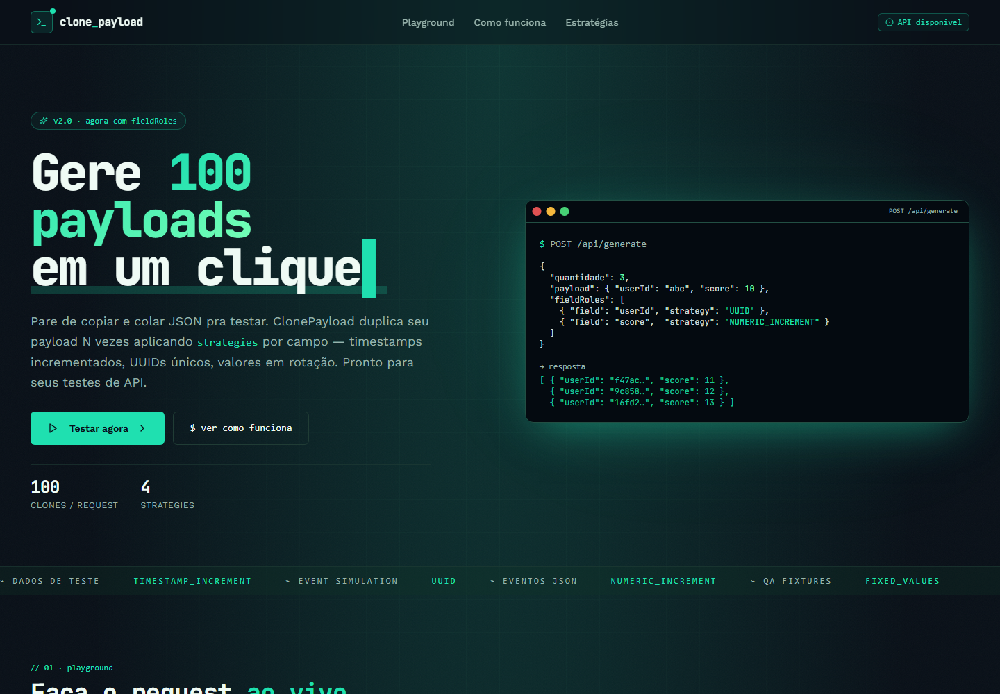
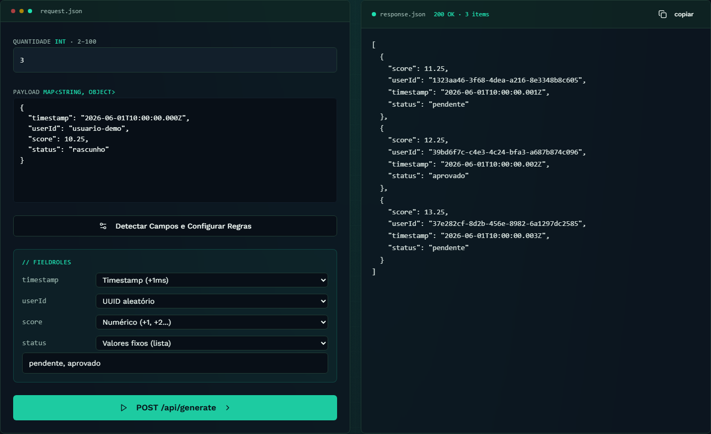

<div align="center">

# ClonePayloads · API Java

**Uma entrada JSON, várias cópias com regras por campo. Sem banco de dados.**


[](https://github.com/ezequieldesr/ClonePayloads_Backend/actions/workflows/ci.yml)

[Executar](#executar-localmente) · [Contrato](#api) · [Testes](#testes) · [Frontend](https://github.com/ezequieldesr/ClonePayloads_Frontend)

</div>

## O projeto

API REST para gerar de 2 a 100 variações de um objeto JSON. Cada campo pode ter uma regra de
incremento de timestamp, incremento numérico, geração de UUID ou rotação de valores fixos.
Permite preparar fixtures, exemplos de eventos e massas de dados para testes.
Não executa testes de carga, não integra Kafka e não precisa de banco de dados.

Desenvolvida em Java 21 e Spring Boot 4. O projeto **já utilizava Boot 4**, sendo atualizado nesta preparação;
não usa o override de Jackson 2 do Nord. A serialização permanece sob o gerenciamento do framework.

## Demonstração

[](https://github.com/ezequieldesr/ClonePayloads_Frontend/blob/main/docs/demo/clonepayloads-demo.mp4)

[▶ Vídeo em PT-BR com a API real](https://github.com/ezequieldesr/ClonePayloads_Frontend/blob/main/docs/demo/clonepayloads-demo.mp4)
· [Roteiro](https://github.com/ezequieldesr/ClonePayloads_Frontend/blob/main/docs/ROTEIRO-DEMONSTRACAO.md)

<details>
<summary><strong>Ver o resultado da geração</strong></summary>



</details>

## Executar localmente

Requisitos: **Java 21**, Maven 3.9+ ou wrapper Maven incluído. Nenhum PostgreSQL ou Docker é necessário para rodar pela JVM.

```bash
git clone https://github.com/ezequieldesr/ClonePayloads_Backend.git
cd ClonePayloads_Backend
mvn spring-boot:run
```

No Windows, o wrapper é `./mvnw.cmd spring-boot:run`; no Linux/macOS, `./mvnw spring-boot:run`.
O `.env` é opcional e não deve ser publicado. Em um clone novo, pode copiar `.env.example` para `.env`.
Se já houver configurações próprias, ajuste somente as chaves necessárias sem sobrescrever segredos.

```dotenv
PORT=8081
CORS_ALLOWED_ORIGINS=http://localhost:8080,http://127.0.0.1:8080
```

Variáveis de ambiente do processo prevalecem sobre `.env`.
Health check: **http://127.0.0.1:8081/api/health** → `{"status":"UP"}`.
A raiz `/` não é uma página da aplicação; a interface é servida pelo frontend.

Para a interface, clone [ClonePayloads_Frontend](https://github.com/ezequieldesr/ClonePayloads_Frontend), execute
`npm ci`, configure `.env.local` pelo exemplo e inicie `npm run dev`.
Abra http://127.0.0.1:8080. Os dois projetos devem permanecer ligados.

## API

### POST /api/generate

```json
{
  "quantidade": 3,
  "payload": {
    "timestamp": "2026-06-01T10:00:00.000Z",
    "userId": "base",
    "score": 10.25,
    "status": "rascunho"
  },
  "fieldRoles": [
    { "field": "timestamp", "strategy": "TIMESTAMP_INCREMENT" },
    { "field": "userId", "strategy": "UUID" },
    { "field": "score", "strategy": "NUMERIC_INCREMENT" },
    { "field": "status", "strategy": "FIXED_VALUES", "values": ["pendente", "aprovado"] }
  ]
}
```

`Content-Type: application/json`. A resposta 200 é **um array direto**, sem wrapper `payloads`.
No exemplo: três objetos, UUIDs distintos, scores 11.25/12.25/13.25, timestamps com +1/+2/+3ms
 e status pendente/aprovado/pendente.

| Estratégia | Requisito e resultado |
| --- | --- |
| TIMESTAMP_INCREMENT | Campo String ISO-8601 existente; +índice em milissegundos |
| NUMERIC_INCREMENT | Campo numérico existente; +índice, preservando decimais |
| UUID | Campo String existente; UUID aleatório por cópia |
| FIXED_VALUES | Campo existente e lista não vazia; rotação circular |

**Compatibilidade:** `fieldRoles` omitido ou nulo incrementa o campo `timestamp`, que passa a ser obrigatório.
`fieldRoles: []` preserva todos os valores. Campos não selecionados por regras permanecem iguais.
As regras atuam nas chaves do primeiro nível; não suportam JSONPath ou caminhos aninhados.

### Limites e erros

- Quantidade: 2–100; payload não nulo/vazio, até 100 campos no primeiro nível.
- Até 100 regras; listas de valores fixos limitadas a 100 itens de até 1000 caracteres.
- Corpo total: **64 KiB**, incluindo metadados e regras; excesso retorna 413.
- JSON, regra ou tipo inválido retorna 400; erros de validação usam mapa de campos e mensagens.
- Erros de negócio retornam `{"error":"mensagem"}`; falhas inesperadas retornam 500 genérico.

A API é pública e não salva os payloads. Não envie dados pessoais reais, tokens ou senhas.
CORS restringe chamadas do navegador, mas não funciona como autenticação ou proteção contra abuso.

## Testes

```bash
mvn -B -ntp verify
```

22 testes backend passaram na preparação: contrato HTTP, validação, tamanho do corpo, limites,
tipos, UUIDs, rotação de valores, timestamps e preservação de decimais.
Não é preciso banco de dados ou servidor externo para a suíte.
Os quatro cenários Playwright ficam no frontend e exercitam a API real:

```bash
npm run test:e2e
npm run demo:record
```

Mantenha os serviços locais ligados e use dados fictícios. [Evidência resumida](docs/demo/verification.json).

## Docker e implantação

```bash
docker build -t clonepayloads-api .
docker run --rm -p 127.0.0.1:8081:8081 clonepayloads-api
```

O Dockerfile executa verify e roda como usuário sem privilégios em Java 21 JRE.
A hospedagem pode fornecer PORT. Configure CORS_ALLOWED_ORIGINS com as origens exatas do frontend,
separadas por vírgula. Não é necessário contratar um banco para esta aplicação.

Antes de expor a terceiros em escala: configure rate limiting na borda, monitoramento, quotas e
controle de acesso conforme a necessidade. Os limites de entrada não impedem ataques de volume.
[Revisão, limitações e proteção de main](docs/CI-SEGURANCA.md).

## Workflows

CI verifica testes e build Docker; CodeQL analisa código; Dependency Review verifica novas dependências
em PRs; Dependabot propõe atualizações semanais. Não há deploy automático neste pipeline.
Envie o backend primeiro: o workflow E2E do frontend usa a main pública deste repositório.
As execuções remotas só acontecem após o envio ao GitHub; a sintaxe foi validada localmente.

## Estrutura

```text
src/main/java/com/example/ClonePayloads/
  controller/    Geração e health check
  dto/           Entrada, regras e limites de validação
  service/       Estratégias de geração
  config/        CORS, headers e limite do corpo HTTP
  global/        Respostas de erro
src/test/        Testes de contrato e estratégias
```

Desenvolvimento informado: junho a julho de 2026. Preparação da demonstração e CI: outubro de 2026.
[Autor: Ezequiel](https://github.com/ezequieldesr).
